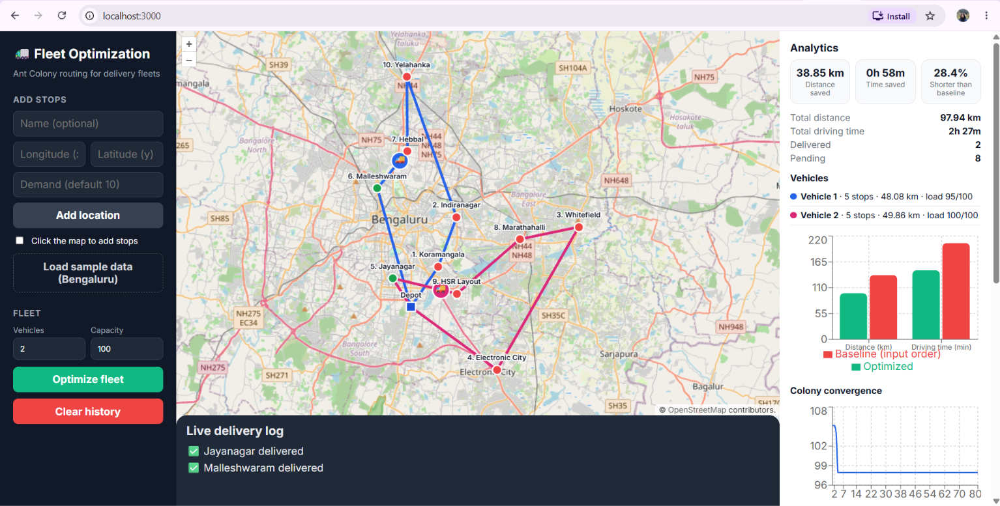
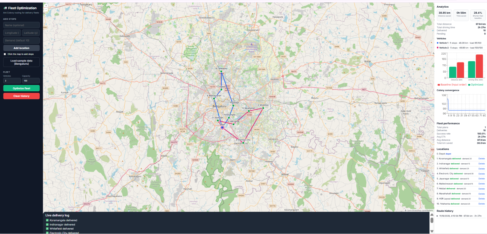
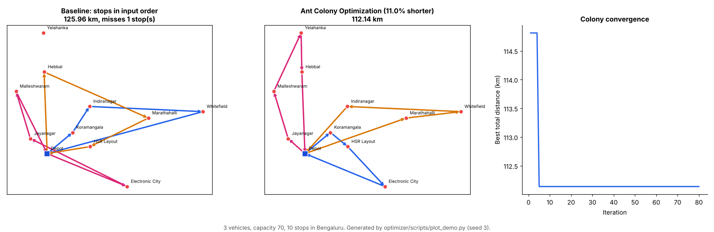
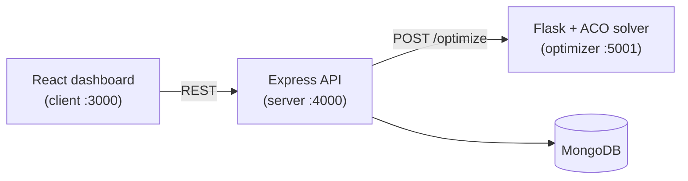

# 🚛 Fleet Route Optimization Platform

[](https://github.com/sampatianvekar/FleetOptimization/actions/workflows/ci.yml)


A full-stack logistics dashboard that plans delivery routes for a fleet with a **MAX-MIN Ant Colony Optimization** solver (Python), stores every plan (Node/Express + MongoDB) and animates it on a live map (React + OpenLayers).




<sub>Screenshot taken offline, so the OpenStreetMap basemap is blank; with internet the map tiles load behind the routes.</sub>



<sub>Real solver output (`python optimizer/scripts/plot_demo.py`). The input-order baseline also strands one stop (Yelahanka) that the optimizer serves, so the saving shown is conservative.</sub>

## Try it in 60 seconds (no database needed)

Open three terminals; run each command from the repo root.

```bash
git clone https://github.com/sampatianvekar/FleetOptimization.git && cd FleetOptimization
pip install -r optimizer/requirements.txt && python optimizer/app.py            # terminal 1
cd server && npm install && USE_MEMORY_DB=true npm start                          # terminal 2 (Windows: set USE_MEMORY_DB=true first)
cd client && npm install && npm start                                             # terminal 3 -> http://localhost:3000
```

Click **Load sample data**, then **Optimize fleet** and watch the trucks drive. `USE_MEMORY_DB=true` keeps plans in memory so MongoDB is optional; remove it (and set `MONGO_URI`) for persistent storage. Clearing history asks for an admin password: set `ADMIN_PASSWORD` and `JWT_SECRET` in `server/.env` first.



## Features

- **Capacitated multi-vehicle routing** – set vehicle count and capacity; every stop is served exactly once, and stops that cannot fit are *reported* (never silently dropped).
- **ACO solver** – MMAS pheromone bounds, elitist deposits, 2-opt local search, reproducible `seed`, 5 s wall-clock budget.
- **Honest baseline** – the "before" plan fills vehicles in input order under the same constraints and the same haversine distance, so *distance saved* is a like-for-like number.
- **Interactive map** – click the map to add stops, colour-coded routes per vehicle, animated trucks that mark stops delivered and persist progress.
- **Analytics** – savings cards, per-vehicle load/distance, baseline-vs-optimised chart, colony convergence curve, persisted fleet metrics and route history.
- **Hardened API** – input validation, rate-limited `/optimize`, helmet headers, env-based config, clear 400/503 errors, and admin login (JWT) protecting history deletion.

## Full setup (with MongoDB)

Prerequisites: Node 20.19+, Python 3.10+, MongoDB (local or Atlas).

```bash
git clone https://github.com/sampatianvekar/FleetOptimization.git
cd FleetOptimization

# 1. optimizer
pip install -r optimizer/requirements.txt
python optimizer/app.py                      # http://127.0.0.1:5001

# 2. API
cd server && cp .env.example .env && npm install   # edit .env: set ADMIN_PASSWORD and JWT_SECRET
npm start                                    # http://localhost:4000

# 3. client
cd ../client && cp .env.example .env && npm install
npm start                                    # http://localhost:3000
```

Or, after installing everything once, run all three with `npm run dev` from the repo root.
Click **Load sample data**, then **Optimize fleet**.

> The optimizer uses port **5001**, not 5000: macOS AirPlay Receiver occupies 5000.

## Configuration

| Variable | Where | Default |
| --- | --- | --- |
| `PORT` | server | `4000` |
| `MONGO_URI` | server | `mongodb://127.0.0.1:27017/fleetDB` |
| `OPTIMIZER_URL` | server | `http://127.0.0.1:5001` |
| `CLIENT_ORIGIN` | server | `http://localhost:3000` (comma separated) |
| `ADMIN_PASSWORD` | server | none – required to clear history |
| `JWT_SECRET` | server | none – 16+ random characters, required to clear history |
| `OPTIMIZER_PORT` / `OPTIMIZER_HOST` | optimizer | `5001` / `127.0.0.1` |
| `REACT_APP_API_URL` | client | `http://localhost:4000` |

## API

| Method | Path | Description |
| --- | --- | --- |
| `POST` | `/optimize` | Body `{ vehicles, capacity?, locations: [{name,x,y,demand}] }` (location 0 = depot, `x` = lon, `y` = lat). Returns routes, distance, ETA, `route_stats`, `baseline`, `unserved`, `convergence`, `routeId`. |
| `GET` | `/routes?limit=25` | Saved plans, newest first |
| `PATCH` | `/routes/:id/stops/:index` | Update a stop's status (`pending`, `in-transit`, `delivered`) |
| `POST` | `/auth/login` | Body `{ password }` → `{ token }` (JWT, 8 h, rate-limited) |
| `DELETE` | `/routes` | Clear history. **Requires** `Authorization: Bearer <token>`; answers 503 if `ADMIN_PASSWORD`/`JWT_SECRET` are not set |
| `GET` | `/metrics` | Aggregate fleet metrics |
| `GET` | `/health` | Liveness |

The optimizer exposes `POST /optimize` and `GET /health` directly; it also accepts `capacities` (per-vehicle list), `avg_speed_kmh`, `service_minutes`, `ants`, `iterations` and `seed`.

## How the solver works

1. Each of *m* ants builds a full plan: starting at the depot it picks the next stop with probability ∝ τ^α · (1/d)^β among stops that still fit in the vehicle, returns to the depot when nothing fits, then starts the next vehicle.
2. The iteration-best plan is improved with 2-opt on every route.
3. Pheromone evaporates, then the iteration-best and global-best plans deposit 1/length; values are clamped to [τmin, τmax] (MMAS) to avoid premature convergence.
4. Plans are ranked by *(unserved stops, total distance)*, so serving everyone always beats a shorter incomplete plan.

## Measured results

Random stops in Bengaluru, demand 10 each, capacity 100, enough vehicles to serve everyone (mean of 4–8 random instances per row; seeds fixed in the benchmark script). "Baseline" = fill vehicles in input order.

| Stops | Baseline km | Previous ACO km | This ACO km | Shorter than baseline | Shorter than previous ACO |
| ---: | ---: | ---: | ---: | ---: | ---: |
| 10 | 159.6 | 90.6 | 81.2 | 49.1 % | 10.4 % |
| 20 | 319.5 | 138.5 | 125.0 | 60.9 % | 9.8 % |
| 40 | 634.2 | 238.5 | 205.0 | 67.7 % | 14.0 % |
| 80 | 1280.6 | 393.7 | 346.2 | 73.0 % | 12.1 % |

Typical solve time is 0.2–1.5 s. Your numbers will vary with the geometry of your stops.

## Tests

```bash
python -m pytest optimizer          # solver + Flask API
npm --prefix server test            # Express API (MongoDB and optimizer are stubbed)
npm --prefix client test -- --watchAll=false
```

## Project structure

```
optimizer/  aco_vrp.py (solver) · app.py (Flask) · tests/
server/     app.js (routes) · index.js (bootstrap) · validate.js · models/ · test/
client/     src/App.js · src/components/ · src/utils/
```

## Design decisions & trade-offs

- **Python for the solver, Node for the API.** NumPy makes the optimization code short and fast; Express is a natural fit for the dashboard's REST calls. The cost is two runtimes, so the API validates input and turns optimizer failures into clear 4xx/503 responses.
- **Baseline computed by the solver, not the UI.** Comparing against a baseline that uses the same distance formula and constraints keeps "distance saved" honest (an earlier version compared two different metrics).
- **Haversine, not road distance.** Straight-line distance keeps the project dependency-free and fast; the trade-off is optimistic ETAs. Road routing (OSRM) is on the roadmap.
- **Unservable stops are reported, never dropped.** Plans are ranked by (unserved stops, distance), so serving everyone always beats a shorter incomplete plan.
- **Dependency injection in the API** (`createApp({ Route, optimizer, auth })`) lets the test suite run without MongoDB or Python, and powers the in-memory demo mode.

## Roadmap

- Vehicle & driver management UI (models exist in `server/models/`)
- Time windows and per-stop service times in the UI
- Road-network distances (OSRM/Valhalla) instead of straight-line
- Per-user accounts and roles (today there is a single admin password that protects destructive actions)

## License

MIT © Sampati Anvekar
